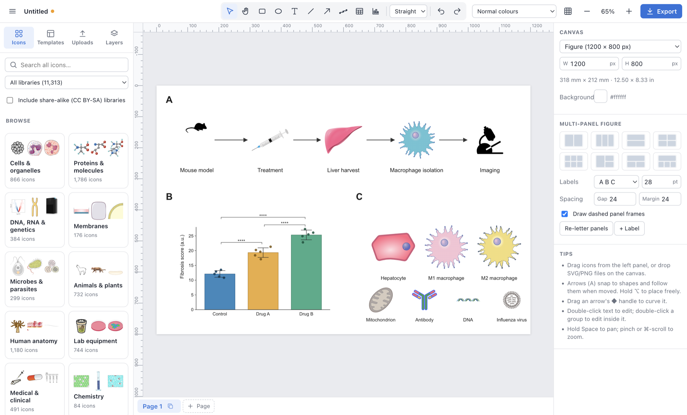
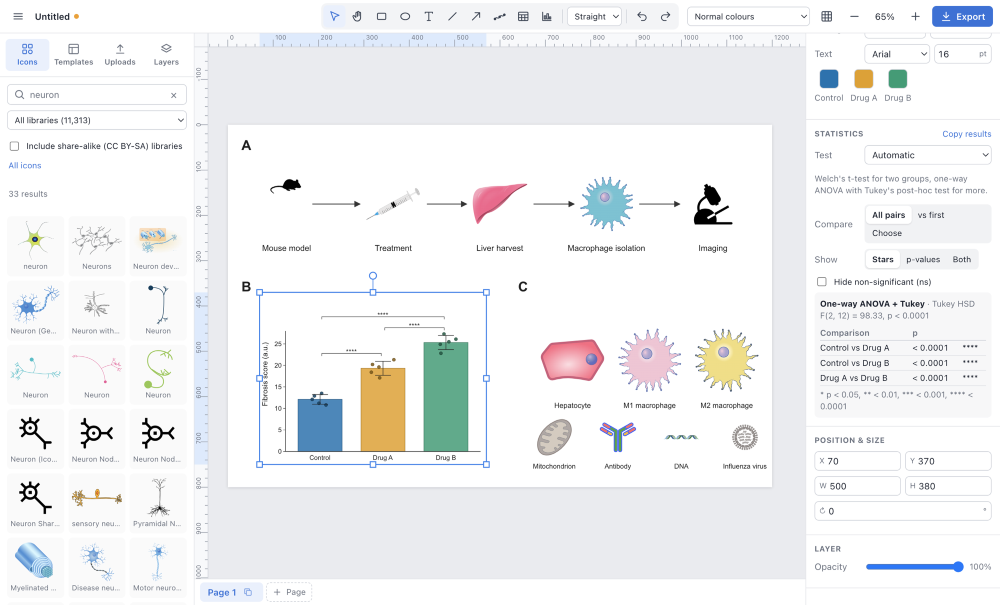

# Pucklet

**A free, open-source desktop app for making scientific figures.** Drag in life-science icons, connect them with arrows that stay attached, plot your data with statistics, and export real vector files that you own.

Pucklet is an attempt to recreate the core features of [BioRender](https://www.biorender.com) as open-source software: no account, no subscription, no watermark, and no licence fee to publish your own figures. It runs on macOS and Windows (and in a browser for development).



> **Status:** early but usable. Pucklet is a personal project and isn't affiliated with BioRender. See [What's missing](#whats-missing) for known gaps.

## Why Pucklet?

- **Over 11,000 open icons, built in.** Ten openly licensed scientific icon libraries, merged into one searchable, browsable catalogue (details [below](#the-icon-library)).
- **Your files stay on your computer.** Figures are local `.pucklet` files (zipped JSON, an open format). Nothing goes to the cloud.
- **True vector export.** SVG, PDF and PowerPoint, plus PNG at up to 1200 dpi.
- **Credits are automatic.** Every icon keeps its author and licence, and export writes the citation line for exactly the icons you used.
- **Made for science.** Membrane and DNA brushes, protocol and timeline builders, charts with statistical tests, multi-panel layouts with A/B/C labels, and colour-blind-safe palettes with previews.

## The icon library

Pucklet doesn't draw its own icons. It gathers them from public, openly licensed collections made by scientists, institutes and illustrators. Pucklet sorts all of them into one tree of 12 categories (cells & organelles, proteins & molecules, DNA & genetics, membranes, microbes, animals & plants, human anatomy, lab equipment, medical, chemistry, symbols and pictograms) with subcategories, so you can browse by topic or search across every library at once.

| Library | Icons | What's in it | Licence |
|---|---:|---|---|
| [Science pictograms via Iconify](https://icon-sets.iconify.design) | 4,078 | Lab, biology and medical glyphs collected from dozens of open icon sets | MIT, Apache-2.0, ISC, CC0, CC BY 4.0 |
| [Reactome](https://reactome.org/icon-lib) | 2,569 | Flat-style molecules, cells, organs and pathway elements from the Reactome pathway knowledgebase | CC BY 4.0 |
| [Bioicons](https://bioicons.com) | 2,459 | Community life-science icons collected by Simon Dürr and contributors | CC0, CC BY 3.0/4.0, MIT, BSD |
| [Health Icons](https://healthicons.org) | 1,498 | Public-health and medical icons, filled and outline styles | CC0 |
| [SciDraw](https://scidraw.io) | 448 | Lab animals, neurons, cells and apparatus drawn by researchers | CC BY 4.0, CC0 |
| [Arcadia Science organisms](https://doi.org/10.5281/zenodo.17203577) | 143 | Research organisms, as silhouettes and in three colours | CC0 |
| [PhyloPic](https://www.phylopic.org) | 77 | Organism silhouettes across the tree of life (a curated set; ~12,000 more available, see below) | Public domain, CC0, CC BY |
| [EMBL-EBI Expression Atlas anatomograms](https://www.ebi.ac.uk/gxa) | 26 | Organ and tissue maps of humans, mice, other animals and plants | CC BY 4.0 |
| [SwissBioPics](https://www.swissbiopics.org) | 15 | Detailed whole-cell illustrations with labelled organelles (SIB) | CC BY 4.0 |
| [BioDraws](https://biodraws.com) *(opt-in)* | 205 | Scientific illustrations under a share-alike licence | CC BY-SA 4.0 |
| **Total** | **11,518** | 11,313 shown by default; 205 more when share-alike is turned on | |

**How licensing works in practice:**

- Every icon carries its author, source and licence into your `.pucklet` file. The export dialog (and the PowerPoint speaker notes) gives a ready-to-paste credit line for your figure legend, such as "Icons adapted from: Liver, Macrophage generic (Reactome, CC BY 4.0)." Icons that need no attribution (CC0, public domain) are left out of it.
- Most icons are CC0 (no conditions) or CC BY (credit the author), which journals generally accept.
- **Share-alike icons are hidden by default.** CC BY-SA means a figure that uses the icon must also be shared under CC BY-SA. To show BioDraws, tick *Include share-alike (CC BY-SA) libraries* under the library menu. Figures that use them get a note in the credit line.
- Icons with non-commercial or no-derivatives licences are left out entirely.

The icons aren't stored in this repository. `npm run icons` downloads them from each source, checks their licences, cleans up the SVGs and builds the catalogue (see [Getting started](#getting-started)). The research behind the choice of sources, and options for growing the library, is in [research/icon-sourcing.md](research/icon-sourcing.md).



## Features

**Drawing and layout**
- Shapes with fill, gradient, stroke, dash and rounded corners; rich text with sub/superscript, Greek and symbol palette.
- Connectors (straight, curved or elbow) that stay attached to shapes and icons as you move them, with arrow, inhibition (⊣), dot and diamond ends and optional labels.
- Smart guides and snapping, align and distribute, groups, a layers panel, rulers and grid, lock and hide.
- Multi-panel layouts (2, 3, 2×2, 3×2, large + small…) with automatic A / a / (a) panel letters and "re-letter in reading order".
- Several pages per file, for figures, supplementary panels or slides.

**Science-specific tools**
- **Brushes**: draw a path and get a lipid bilayer, monolayer, DNA double helix or bead filament; close the loop for a cell membrane. Any icon can also be repeated along a path.
- **Protocol and timeline builders**: type one step per line ("Day 7: Start treatment") and Pucklet lays out numbered markers, labels and arrows. Edit the text and the layout rebuilds itself.
- **Templates**: starter figures (cell signalling, membrane transport, graphical abstract and more). You can also save your own.
- **Icons**: recolour each colour layer, flip, crop (rectangle, rounded or circle), and select every copy of an icon at once. You can also import your own SVG, PNG, JPG, GIF or WebP files.
- **Accessibility**: an Okabe–Ito colour-blind-safe palette, plus grayscale and colour-blindness previews.

**Charts, tables and statistics**
- Paste cells from Excel, Google Sheets or Prism, or import CSV, TSV or `.xlsx`. Pucklet recognises the layout and suggests a chart.
- 16 chart types: bar (mean ± SD/SEM/95% CI with points), dot, box, violin, mean ± error line, histogram, grouped and stacked bars, pie and donut, scatter and line with linear fit and R², heatmap, well-plate heatmap (6–384 wells), Kaplan–Meier survival and volcano plot.
- **Statistics on grouped charts**: Welch's or paired t-test, Mann–Whitney U, one-way ANOVA with Tukey's HSD, or Kruskal–Wallis with Dunn's test (Holm-adjusted). Compare all pairs, each group against the first, or pairs you choose. Significance brackets stack above the bars, showing stars (* < 0.05 … **** < 0.0001) and/or p-values. The results table copies as text for your methods section.
- Tables you can type into directly on the canvas, with publication-style rules and aligned numbers.

**Export**
- SVG, vector PDF, PNG at 72–1200 dpi (with the correct DPI tag), and PowerPoint. In PowerPoint, text, shapes, tables and straight arrows stay editable. Transparent backgrounds are supported, and multi-page files export all pages at once.
- Copy and paste as SVG to and from Illustrator, Inkscape and other apps.

## Getting started

Pucklet doesn't publish ready-made downloads yet, so you build it from source. You'll need [Node.js](https://nodejs.org) 22 or newer.

```bash
git clone https://github.com/BrentKey/Pucklet.git
cd Pucklet
npm install
npm run icons      # downloads and prepares the icon libraries (allow 20–30 minutes)
npm run dev        # opens the desktop app with live reload
```

To build an installer for your own computer:

```bash
npm run dist:mac   # creates dist/Pucklet-<version>.dmg
npm run dist:win   # creates dist/Pucklet-<version>.exe
```

The Mac app isn't code-signed yet, so the first time you open it macOS asks for confirmation. Right-click the app and choose **Open**.

## How Pucklet compares with BioRender

Pucklet covers most of BioRender's everyday figure-making: icons, connectors, brushes, templates, panels, charts and export. It goes further in a few places, such as a layers panel, recolourable brushes, statistical tests on charts and offline files. The biggest gaps are the size and consistent house style of BioRender's ~50,000-icon library, real-time collaboration and AI features. A full feature-by-feature comparison is in [research/feature-gaps.md](research/feature-gaps.md), and background research on BioRender is in [research/biorender-research.md](research/biorender-research.md).

## What's missing

- **Icons**: the library is smaller and less uniform in style than BioRender's. TogoTV and OpenClipart importers exist but aren't part of `npm run icons` yet (`npm run icons:togotv`, `npm run icons:openclipart-science`).
- **Collaboration**: no real-time co-editing or comments yet. The document model (a Yjs CRDT) is built to allow it.
- **Editing polish**: no Bézier pen tool, curved text, or in-place editing of rotated text.
- **PowerPoint**: curved/elbow connectors and inhibition ends export as pictures rather than native lines.
- **Packaging**: no code signing, notarisation or auto-update yet.

## For developers

| Command | What it does |
|---|---|
| `npm run dev` | Desktop app (Electron) with hot reload |
| `npm run web` | The same UI in a browser at http://localhost:5199 |
| `npm test` | Unit tests (document model, connectors, file format, data import, statistics) |
| `npm run typecheck` | Type-checks the main, preload and renderer code |
| `npm run build` / `npm start` | Production build, then run it |
| `npm run icons:<library>` | Rebuild one icon library, e.g. `icons:reactome`. `npm run icons:phylopic -- --all` fetches every suitably licensed PhyloPic silhouette (~12,000). `npm run icons -- --include-sa` also includes Bioicons' share-alike icons. |
| `npm run icon` | Re-renders the app icon from `build/icon.svg` |
| `PUCKLET_SMOKE_DIR=/some/dir npx electron .` | After `npm run build`: launches the app, saves a screenshot, a test PDF and a report, then quits |

```
src/main/            Electron main process: window, menus, file dialogs, PDF export
src/preload/         The only bridge from the UI to Electron (contextIsolation + sandbox)
src/renderer/src/
  model/             Document model (Yjs), geometry, operations, file format, statistics
  render/            The one SVG renderer, used for both the canvas and every export
  canvas/            Interaction: tools, selection handles, text editor, viewport
  assets/            SVG sanitizing, recolouring, raster import
  library/           Icon packs, the category tree and templates
  export/            SVG/PNG/PPTX export, DPI tagging, credit lines
  platform/          Electron vs browser adapters
  ui/                Panels, toolbar, dialogs
scripts/             Icon-library builders (one per source)
research/            BioRender feature, UX and icon-sourcing research
```

**Design choices**
- The canvas is plain SVG in the page, not a bitmap canvas library. Icons render exactly as drawn, recolouring is an attribute change, and SVG export loses nothing.
- The document is a Yjs CRDT: a flat object map with stable ids and fractional-index z-order. It gives undo/redo today and room for real-time collaboration later.
- All operating-system access goes through `platform/`, so the same UI runs in a browser.
- Imported SVGs are sanitized (scripts, event handlers, `foreignObject` and external references are removed). In production, the UI loads from a custom `app://` scheme with a strict Content-Security-Policy.
- All dependencies are permissively licensed (MIT, ISC, Apache-2.0 or CC0).

Bug reports and pull requests are welcome. New templates are easy to add in `src/renderer/src/library/templates.ts`.

## Licence

Pucklet is released under the [Mozilla Public License 2.0](LICENSE). Anyone can use, embed or ship it, including commercially. Changes to its source files must be shared under the same licence. Icons keep their own licences, listed above and in every export's credit line.
